# 🏢 Implementing & Managing Active Directory in Windows Server

[](https://www.microsoft.com/windows-server)
[](https://learn.microsoft.com/windows-server/identity/ad-ds/active-directory-domain-services)
[](https://learn.microsoft.com/previous-versions/windows/desktop/policy/group-policy-start-page)
[](https://learn.microsoft.com/powershell/)
[](https://www.virtualbox.org)

> **Deployment and administration of an Active Directory domain on Windows Server 2022 — domain controller, organizational units, users and groups, Group Policy security, domain-joined clients, and account-level controls.**
> Completed as a course-end capstone for the **Advanced Executive Program in Cybersecurity — IIIT Bangalore**.

---

## 📌 Disclaimer

All configuration was performed in a **controlled, isolated lab** of Windows Server 2022 virtual machines built specifically for this academic capstone. The domain, accounts, and policies are **fictional** — no production systems and no real user data were involved. This repository documents completed work for **educational and portfolio purposes only**.

---

## 🎯 Objective & Scenario

Large IT environments struggle with user authentication, resource access, and policy enforcement. Without a structured Active Directory, organizations face **unauthorized access, inefficient user management, and weak policy enforcement**.

**My goal:** stand up a Windows Server 2022 domain controller, structure the domain with Organizational Units, centralize identity with users and security groups, enforce security through Group Policy Objects, join a client to the domain, and apply account-level controls — demonstrating centralized authentication and enterprise access control end to end.

---

## 🧭 Environment

| Role | Hostname | IP | Detail |
|------|----------|-----|--------|
| **Domain Controller** | `DC001` | `10.0.2.6` | Hosts the `mydomain.local` forest/domain |
| **Client** | `client001` | `10.0.2.7` | Joins the domain; DNS pointed at the DC |
| **Gateway** | — | `10.0.2.1` | Shared default gateway |

Two Windows Server 2022 virtual machines. The client uses the domain controller as its DNS server so it can locate and authenticate against the domain.

---

## 🧰 Tools & Technologies

| Tool | Purpose |
|------|---------|
| **Windows Server 2022** | Operating system hosting the domain and enterprise services |
| **Active Directory Domain Services (AD DS)** | Centralized authentication and policy enforcement |
| **Group Policy Objects (GPOs)** | Domain-wide security and configuration enforcement |
| **Active Directory Users and Computers (ADUC)** | Managing OUs, users, groups, and account settings |
| **PowerShell** | Command-line equivalents for reproducible setup |
| **Windows Defender Firewall** | Enforcing network security rules |

---

## 🗺️ Methodology

The build followed the five tasks defined in the project brief, in order:

1. **Install & configure AD DS** — promote the server to a domain controller for `mydomain.local`.
2. **OUs, users & security groups** — structure the domain and centralize identity by role.
3. **Group Policy Objects** — enforce account lockout and password policy domain-wide.
4. **Join client systems** — move a client into the domain and verify AD authentication.
5. **Security measures** — apply logon-hour restrictions, account disabling, and lockout enforcement.

> Full command notes (with PowerShell equivalents) live in [`docs/commands .docx`](docs/commands%20.docx). Complete write-up with figures: [`docs/Implementing_and_Managing_Active_Directory.docx`](docs/Implementing_and_Managing_Active_Directory.docx).

---

## ⚙️ Implementation

### Task 1 — Installing & configuring AD DS (domain controller)

A static IP was assigned so the server can act as a stable domain controller, and the host was renamed to **`DC001`** for a clear, identifiable name.

```powershell
# IP 10.0.2.6 / 255.255.255.0 / gateway 10.0.2.1
Rename-Computer -NewName DC001 -Restart
```

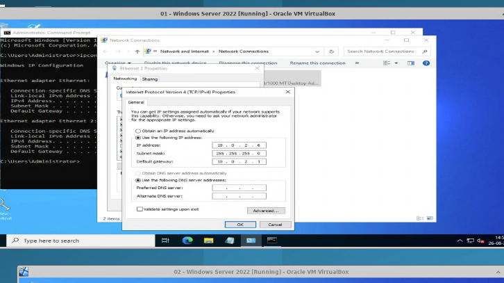
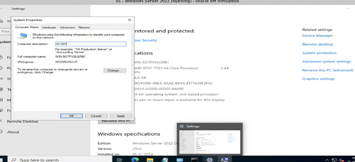

The **Add Roles and Features Wizard** was used to install the AD DS role and its management tools.

```powershell
Install-WindowsFeature AD-Domain-Services -IncludeManagementTools
```

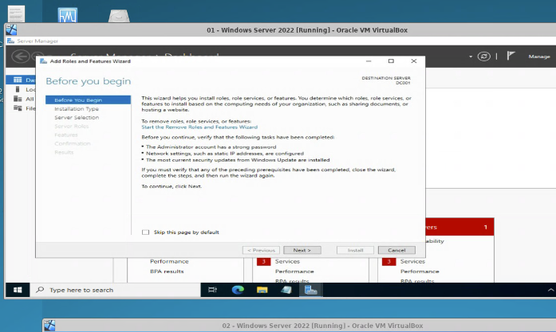
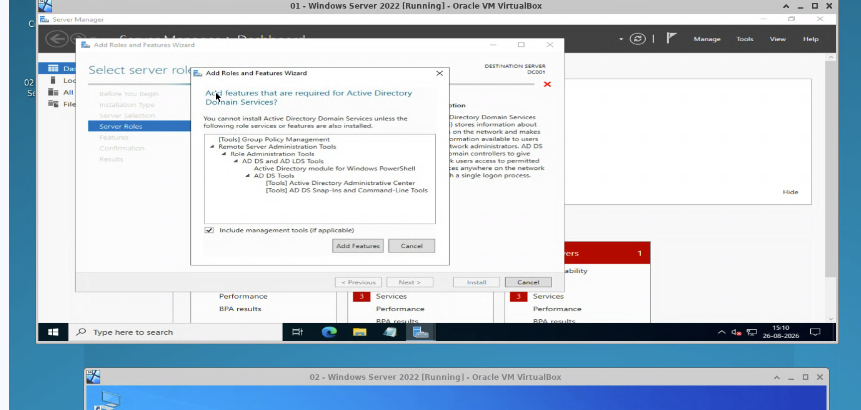
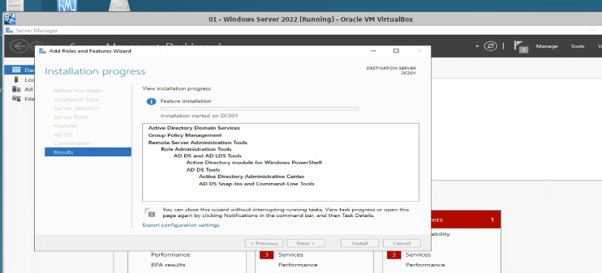

The server was then promoted to a domain controller, creating the new forest and domain **`mydomain.local`**.

```powershell
Install-ADDSForest -DomainName mydomain.local
```

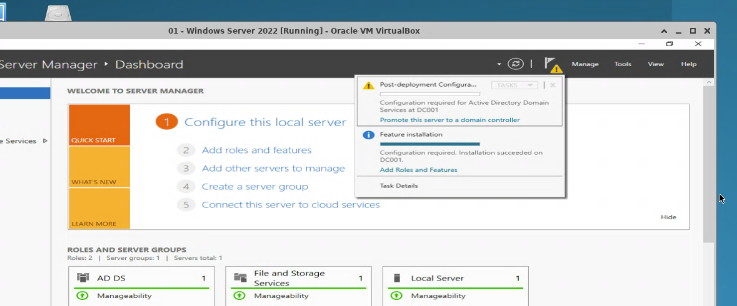

### Task 2 — Organizational Units, users & security groups

Organizational Units such as **NOC** and **SOC** were created to structure the domain by function. User accounts (`trainer`, `watson`) were created and added to the appropriate security group to define their roles and access.

```powershell
New-ADOrganizationalUnit -Name "NOC"
New-ADOrganizationalUnit -Name "SOC"
New-ADUser -Name "trainer" -Enabled $true -AccountPassword (Read-Host -AsSecureString)
New-ADUser -Name "watson"  -Enabled $true -AccountPassword (Read-Host -AsSecureString)
Add-ADGroupMember -Identity "Research" -Members trainer,watson
```

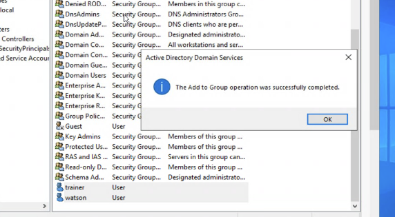

### Task 3 — Group Policy Objects (GPOs)

Group Policy enforced domain-wide security via the **Default Domain Policy**. The account lockout threshold was set to **3 invalid logon attempts**, with a 30-minute lockout duration and reset counter; password length, complexity, and age were enforced the same way.

```powershell
net accounts /lockoutthreshold:3 /lockoutduration:30 /lockoutwindow:30
net accounts /minpwlen:14 /maxpwage:90 /minpwage:70
gpupdate /force
```

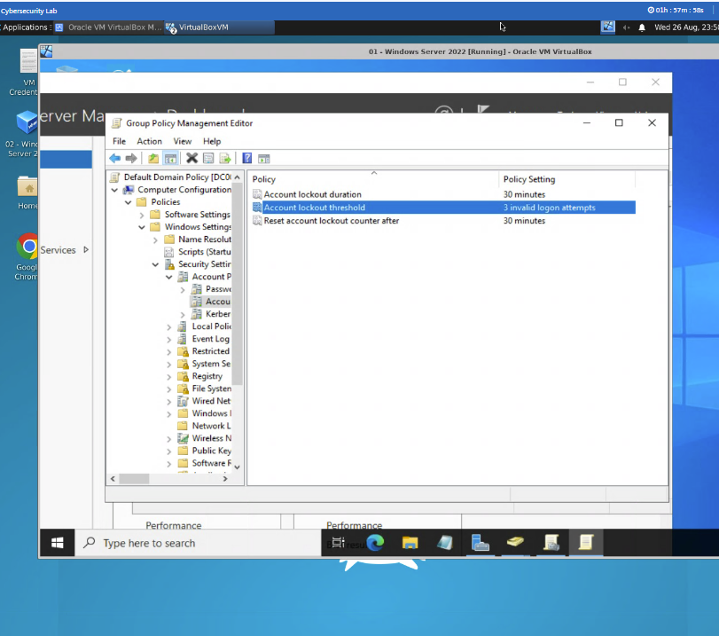

### Task 4 — Joining client systems to the domain

The client was given a static IP with its **preferred DNS pointed to the domain controller**, so it can resolve and locate the domain. It was then moved from a workgroup into `mydomain.local` and restarted.

```powershell
# Client: IP 10.0.2.7, DNS 10.0.2.1 (the DC)
Add-Computer -DomainName mydomain.local -Restart
```

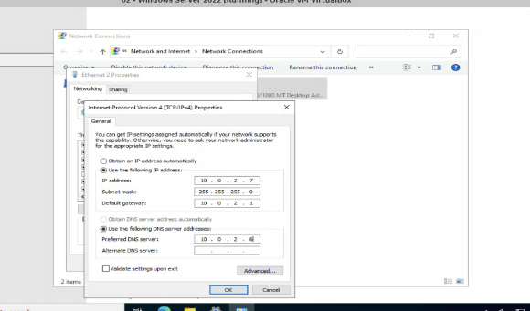
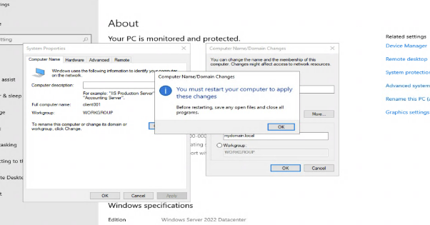
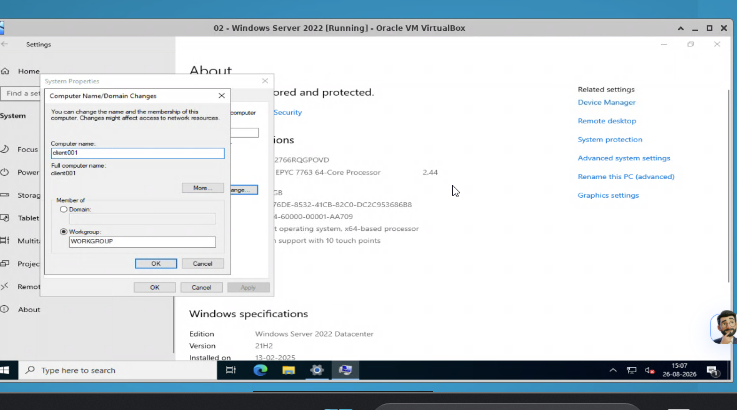
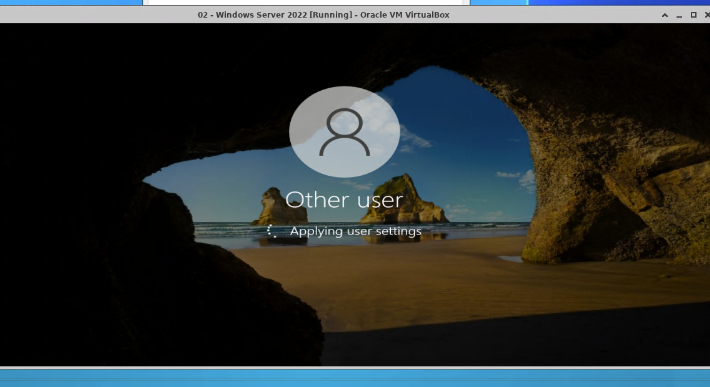

Domain authentication was verified from the client. Signing in as the domain administrator and running `whoami` returned `mydomain\administrator`; a standard user (`watson`) and the `trainer` account were tested the same way.

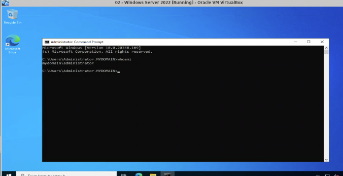
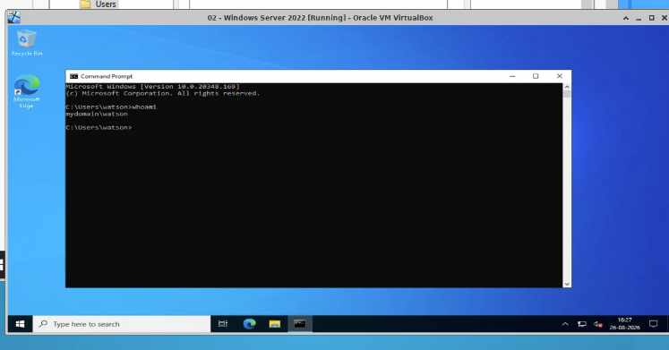
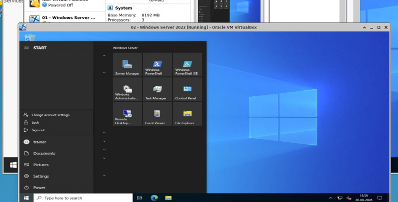

### Task 5 — Security measures (login restrictions, lockout & account state)

**Logon-hour restrictions** were configured for `watson`, controlling the days and times the user may sign in.

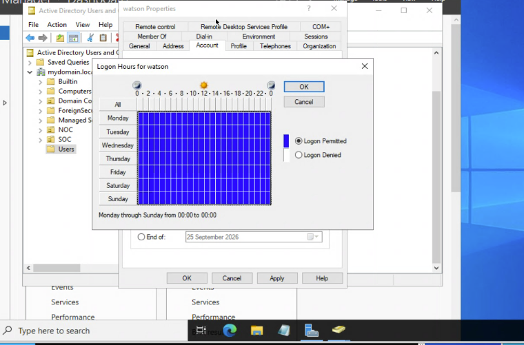

Accounts can be **disabled** to revoke access — with `trainer` disabled, sign-in is blocked with an account-disabled message.

```powershell
Disable-ADAccount -Identity trainer
```

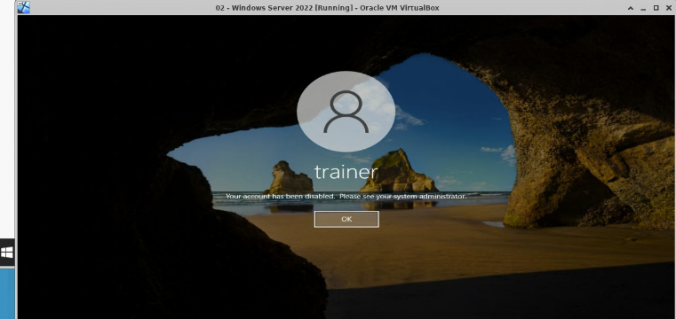

Finally, the **lockout policy was validated** — after exceeding 3 invalid attempts, the `watson` account was automatically locked until reset.

```powershell
Unlock-ADAccount -Identity watson     # reset after lockout
```

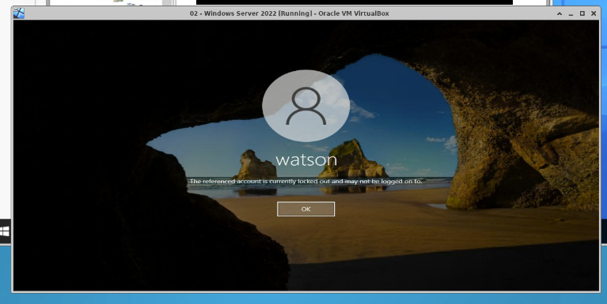

---

## 🛡️ Controls Implemented

| # | Control | Mechanism | Purpose |
|---|---------|-----------|---------|
| 1 | Centralized identity | AD DS domain controller | Single source of authentication |
| 2 | Structured access | Organizational Units + security groups | Role-based organization |
| 3 | Account lockout | GPO — 3 attempts, 30-min lockout | Blunt brute-force attempts |
| 4 | Strong passwords | GPO — length, complexity, age | Resist credential attacks |
| 5 | Time-based access | Logon-hour restrictions | Limit sign-in to approved hours |
| 6 | Access revocation | Account disable / lockout | Cut off compromised or inactive users |

---

## 🧠 Key Takeaways

1. **Centralization is the security win.** Moving authentication into AD DS replaces scattered local accounts with one controllable, auditable identity source.
2. **DNS is the linchpin of domain join.** Pointing the client's DNS at the domain controller is what lets it find and authenticate against the domain — a step that silently breaks the join if missed.
3. **Group Policy enforces at scale.** One lockout and password policy on the Default Domain Policy applies to every account at once, rather than being set machine by machine.
4. **Account state is an active control.** Logon hours, disabling, and lockout turn identity management into a live security tool, not just user administration.

---

## 📂 Repository Structure

```
Implementing-and-Managing-Active-Directory-in-Windows-Server/
├── README.md                                       ← this file
├── docs/
│   ├── Implementing_and_Managing_Active_Directory.docx   ← full write-up with figures
│   ├── commands .docx                              ← key commands + PowerShell equivalents
│   └── 1749706299_capstone_project_problem_statement_03.pdf   ← project brief
└── images/                                         ← evidence screenshots
    ├── ethernet2setup.png       ← DC static IP            ├── clientsetup.png          ← client network/DNS
    ├── naming.png               ← renamed to DC001        ├── clientdomainadd.png      ← domain join dialog
    ├── addingroles.png          ← Add Roles wizard        ├── client001.png            ← client joined
    ├── adserv.png               ← AD DS role selected     ├── clientmydomainlogin.png  ← first domain login
    ├── adservinstall.png        ← AD DS installed         ├── cmdclient.png            ← whoami administrator
    ├── promote.png              ← promoted to DC          ├── watson.png               ← whoami watson
    ├── groupadd.png             ← users added to group    ├── traineruser.png          ← trainer session
    ├── accpolicy.png            ← lockout/password GPO     ├── logonhours.png           ← logon-hour limits
    ├── useracdisabled.png       ← disabled account        └── 3loginattempts.png       ← lockout validated
```

---

## 👤 Author

**Saikiran Tammali** — Cybersecurity Graduate · SOC / Vulnerability Management

[](https://www.linkedin.com/in/saikiran-tammali-cybersec32)
[](https://github.com/SAIKIRAN-TAMMALI)

*Course-end capstone — Advanced Executive Program in Cybersecurity, IIIT Bangalore.*
